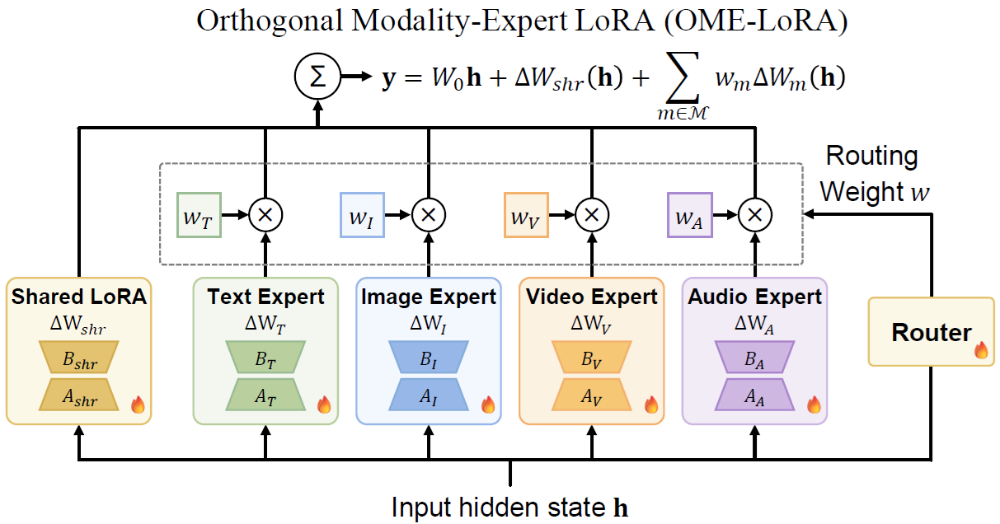

# Syn-Omni: Structured Specialization and Progressive Collaboration for Omnimodal Embeddings

Youngtaek Oh, Qiyu Wu, Hiromi Wakaki, Junmo Kim, Yuki Mitsufuji

EMNLP 2026 Findings

📄 [Paper](https://aclanthology.org/2026.findings-emnlp.1178/)

This repository contains the training and evaluation codes:

- `tevatron/`: training code for Uni-Omni and Syn-Omni.
- `vlm2vec_eval/`: evaluation on 81 tasks across image, video, audio, and audiovisual modalities, plus scripts for 5 baseline models.

The training code is a reproduced version of our original implementation. It can be used to train your own Uni-Omni/Syn-Omni checkpoints.

## Abstract

Omnimodal embeddings naturally involve both shared representations and modality-specific features across heterogeneous inputs. However, existing omnimodal embedding methods often rely on a single shared parameter space over mixed-modality data, limiting structural separation between universal and modality-specific representations. To address this, we propose Syn-Omni, a unified framework for structured omnimodal adaptation with modality specialization and controlled cross-modal collaboration. Specifically, we introduce Orthogonal Modality-Expert LoRA (OME-LoRA), which decomposes adaptation into a shared LoRA path for universal semantics and modality-expert LoRA paths for modality-aware specialization. Furthermore, Progressive Synergy Routing (PSR) enables experts to first establish modality-specific priors, then gradually interact with other modality-experts for cross-modal synergy. Evaluated across 81 diverse tasks spanning image, video, audio, and audiovisual modalities, Syn-Omni consistently outperforms omnimodal baselines, demonstrating the effectiveness of structured specialization and cross-modal progressive collaboration.

<p align="center">
  
</p>

<br />

## Installation

### Install via Docker (Recommended)

```bash
cd docker
docker build --build-arg USER_ID=$UID -t omniembed:v0 .

docker run --gpus all -it --shm-size=128gb \
    -v <path/to/code>:/home/appuser/omni \
    -v <path/to/datasets>:/home/appuser/datasets \
    -v <path/to/.cache/huggingface>:/home/appuser/.cache/huggingface \
    -v <path/to/.cache/torch/hub>:/home/appuser/.cache/torch/hub \
    --name synomni omniembed:v0
```

### Install without Docker

```bash
cd vlm2vec_eval
pip install -r requirements_local.txt
```

This installs everything the Docker image normally provides. See the comments at the top of the file for install order.

Install flash-attn separately, last:

```bash
pip install flash_attn==2.8.3 --no-build-isolation
```

### Training Code

Then install the training code from the repository root:

```bash
pip install -e tevatron
```

<br />

## Training

Run from `tevatron/`. Paths (`DATA_ROOT`, `OUTPUT_BASEDIR`) are set in `scripts/env.sh`.

### Training Dataset Setup

```bash
cd tevatron
bash scripts/download_data.sh
```

Downloads all datasets in `configs/syn_omni.yaml`. Rerun to resume if interrupted.

<sub>Note: Due to licensing and redistribution constraints, the following training datasets used in the paper are excluded: AudioSet (audio-visual), FineCVR, VAST, InternVideo2, and Shot2Story. AVInstruct includes only publicly available videos (3,478 of 19,768). Results may therefore differ from the paper. All datasets remain subject to their own licenses and terms of use.</sub>

### Run Training

| Model | Script |
|---|---|
| Syn-Omni 3B | `scripts/syn_omni_3b.sh` |
| Syn-Omni 7B | `scripts/syn_omni_7b.sh` |
| Uni-Omni 3B | `scripts/uni_omni_3b.sh` |
| Uni-Omni 7B | `scripts/uni_omni_7b.sh` |

```bash
bash scripts/syn_omni_3b.sh
```

Checkpoints are saved to `$OUTPUT_BASEDIR/<model>/checkpoints` (e.g. `syn-omni-3b/checkpoints`).

### GPU Memory

- 3B: 80GB per GPU recommended; the default `--gc_q_chunk_size` / `--gc_p_chunk_size` also fit 40GB.
- 7B: 141GB per GPU.

<br />

## Evaluation

All eval commands run from `vlm2vec_eval/`. The eval scripts live under `scripts/` and share `scripts/env.sh` for `DATA_BASEDIR`/`OUTPUT_BASEDIR`.

### Eval Dataset Setup

1. Download MMEB-V2 (image/video tasks) once:

   ```bash
   cd vlm2vec_eval
   DATA_BASEDIR=/path/to/vlm2vec_eval_data bash experiments/public/data/download_data.sh
   ```

   - Defaults to `/home/appuser/datasets/vlm2vec_eval` if unset.
   - Also settable via `scripts/env.sh`.

2. Everything else (audio and audiovisual) downloads automatically the first time you run an eval script. No manual step needed.

### Evaluate Your Trained Model

Pass the training output directory to the script for each model under `scripts/syn_omni/` (`syn_omni_3b.sh`, `syn_omni_7b.sh`, `uni_omni_3b.sh`, `uni_omni_7b.sh`):

```bash
cd vlm2vec_eval
bash scripts/syn_omni/syn_omni_3b.sh /path/to/outputs/syn-omni-3b/checkpoints
```

### Baselines

One script per model under `scripts/baselines/`. Most load their checkpoint from a public HF repo id and run as-is.

- `eval_wave.sh` expects `tsinghua-ee/WAVE-7B` downloaded locally first.
- `multivent.sh` expects `Tevatron/OmniEmbed-v0.1-multivent` downloaded locally first.

<br />

## Useful Guide

Training (`tevatron/`):

- `configs/syn_omni.yaml`: training dataset mixture.
- `src/tevatron/retriever/datasets/`: dataset loaders and downloaders.
- `src/tevatron/retriever/modeling/lora/`: OME-LoRA and PSR.
- `src/tevatron/retriever/trainer/`: GradCache trainer.
- `src/tevatron/retriever/driver/train_mm.py`: training entry point.

Evaluation (`vlm2vec_eval/`):

- `src/model/`: model/backbone loading, including the custom router-based LoRA (OME-LoRA / PSR) used by Syn-Omni.
- `src/data/eval_dataset/`: per-dataset eval loaders.
- `src/data/collator/`: batch collation, including on-the-fly video/audio decoding.
- `src/constant/`: dataset name to HF/source mapping.
- `src/utils/`: download helpers, eval utilities.
- `experiments/public/eval/*.yaml`: per-modality dataset configs.
- `scripts/baselines/`: eval scripts for baseline models.

<br />

## Acknowledgements

- Built on top of [VLM2Vec](https://github.com/TIGER-AI-Lab/VLM2Vec) ([Apache License 2.0](https://github.com/TIGER-AI-Lab/VLM2Vec/blob/main/LICENSE)). This repository is a modified fork, released under the same license.
- The training code builds on [Tevatron](https://github.com/texttron/tevatron) ([Apache License 2.0](https://github.com/texttron/tevatron/blob/main/LICENSE)).

<br />

## Citation

```bibtex
@inproceedings{oh2026syn,
  title={Syn-Omni: Structured Specialization and Progressive Collaboration for Omnimodal Embeddings},
  author={Oh, Youngtaek and Wu, Qiyu and Wakaki, Hiromi and Kim, Junmo and Mitsufuji, Yuki},
  booktitle={Findings of the Association for Computational Linguistics: EMNLP 2026},
  pages={24889--24915},
  year={2026}
}
```
